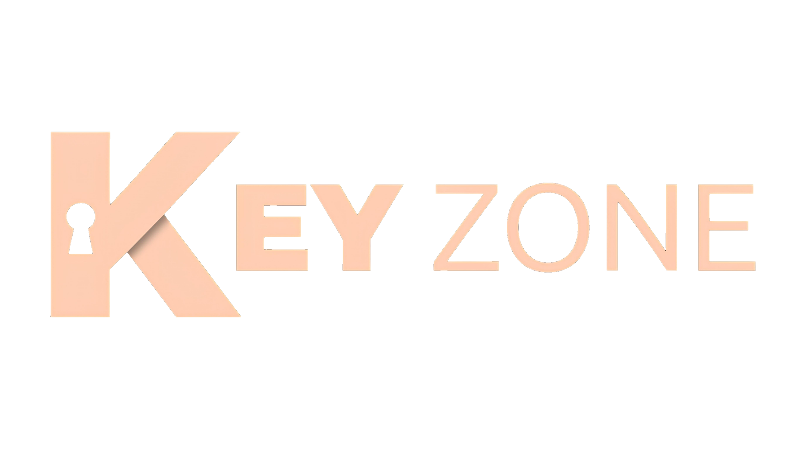
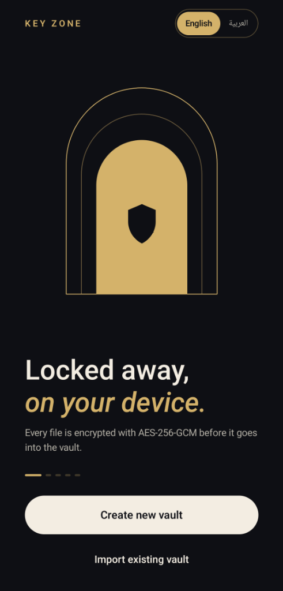
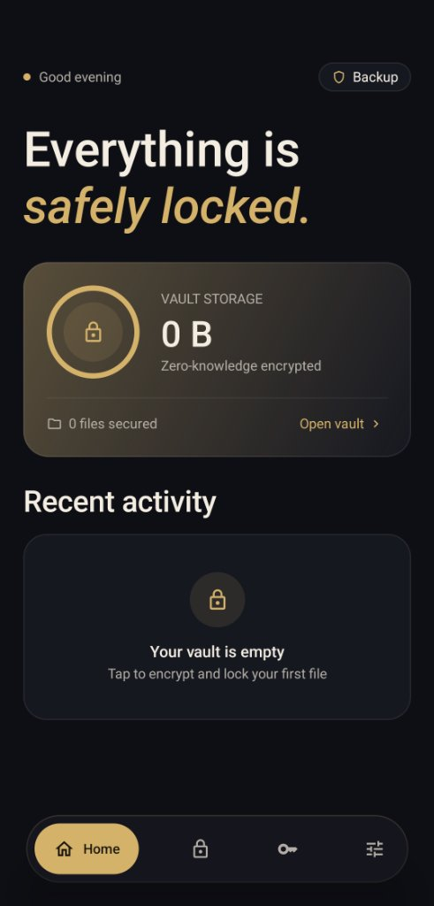
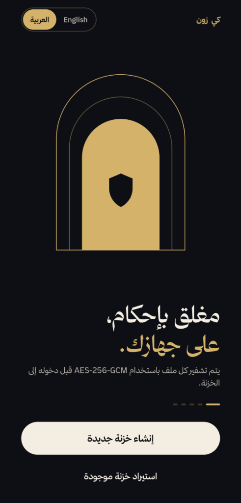
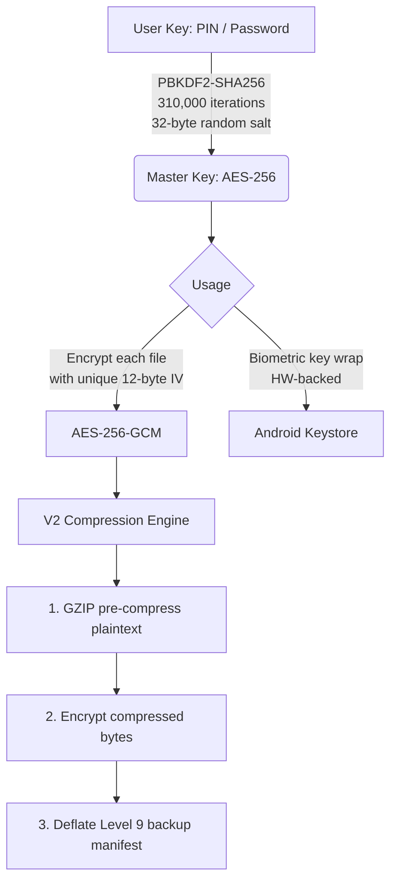

<div align="center">


<br>

**Zero-knowledge file encryption. Offline. On your device.**

[](https://en.wikipedia.org/wiki/Galois/Counter_Mode)
[](https://en.wikipedia.org/wiki/PBKDF2)
[](https://datatracker.ietf.org/doc/html/rfc6238)
<br>
[](https://kotlinlang.org/)
[](https://developer.android.com/)
[](LICENSE)

> Every file is encrypted with AES-256-GCM before it enters the vault.  
> No cloud. No accounts. No telemetry. **Your key never leaves your device.**

</div>

---

## 📸 Screenshots

<table align="center">
  <tr>
    <td align="center"><b>Welcome (English)</b></td>
    <td align="center"><b>Home Dashboard</b></td>
    <td align="center"><b>Welcome (Arabic)</b></td>
  </tr>
  <tr>
    <td></td>
    <td></td>
    <td></td>
  </tr>
</table>

<p align="center">
  <i>Full RTL (Right-to-Left) support is integrated directly into the design.</i>
</p>

---

## ✨ Features

### 🔒 Security Architecture
- **AES-256-GCM Encryption**: Authenticated encryption. Every file gets a unique 12-byte IV.
- **PBKDF2-SHA256 Key Derivation**: Uses 310,000 iterations + a 32-byte random salt.
- **Zero-Knowledge Design**: The raw key is never stored; only salted derivation data persists.
- **Hardware-Backed Android Keystore**: Secure biometric unlock using AES-256-GCM key wrapping.
- **Anti-Screenshot (`FLAG_SECURE`)**: Applied app-wide to prevent screen capture and hide recents thumbnails.
- **Auto-Lock on Background**: The vault locks immediately when the app leaves the foreground.

### 🗂️ The Vault
- **Universal File Support**: Encrypt any file type from device storage via the Storage Access Framework (SAF).
- **Flexible UI**: Switch between a compact list and a visual grid view.
- **Multi-Sort**: Sort by name, date, size, or type (ascending & descending).
- **Detailed File Info**: View name, size, encrypted size, compression ratio, date, and MIME type.
- **In-Vault Rename**: Rename files seamlessly without decryption.
- **Direct SAF Export**: Decrypt and export a file back to any folder or app securely.
- **Quick Actions**: Floating Action Button (FAB) quick-encrypt shortcut available on every screen.

### 🖥️ Lock Screen & Authentication
- **Custom Credentials**: Supports a 4–8 digit PIN or an alphanumeric password.
- **Dynamic Keypad**: Auto-advances on the final PIN digit (no confirm tap needed).
- **Biometric Unlock**: One-tap unlock with hardware-backed key unwrapping.
- **Haptic Feedback**: Tactile response on every keypress.
- **Visual Error Feedback**: Shake animation + red glow on incorrect entry.
- **Rate-Limiting Lockout**: Exponential delay after 5 consecutive failures, with a countdown banner.

### 📦 Backup & 2FA (RFC 6238 TOTP)
- **Offline TOTP Engine**: RFC 6238 compliant, fully compatible with Google Authenticator, Authy, etc.
- **Secure Secret**: Uses a 160-bit (20-byte) cryptographically secure Base32 secret key.
- **Easy Enrollment**: Standard `otpauth://totp/` URI and QR code for authenticator apps.
- **Recovery Codes**: Single-use backup recovery codes (stored hashed using HMAC-SHA256).
- **Clock-Drift Tolerance**: Checks counter −1, 0, +1 (±30 second window) to prevent sync issues.
- **Replay Protection**: Verifies last-used counter; brute-force lockout after 5 incorrect codes.
- **Dual-Stage Compression**: GZIP pre-compression (V2 engine) + Deflate Level 9 manifest compression.
- **Flexible Export**: Export backups to device files (SAF `CreateDocument`) or share via any app.

### ⚙️ Settings & Control
| Section | Available Options |
|---|---|
| **Security & Access Control** | Toggle biometric unlock, Auto-lock on background, Anti-screenshot |
| **Storage & Data** | Delete original after encrypting (default), Storage breakdown, Clear decrypted cache |
| **Danger Zone** | Lock Now, Reset & Destroy Vault (requires confirmation dialog) |

---

## 🏗️ Architecture



### TOTP Backup Flow

<table align="center">
  <tr>
    <th>Enrollment Phase</th>
    <th>Import Phase</th>
  </tr>
  <tr>
    <td>
      1. Generate 160-bit secret<br>
      2. Build <code>otpauth://</code> URI<br>
      3. Render QR code<br>
      4. User scans into Authenticator<br>
      5. Store hashed recovery codes
    </td>
    <td>
      1. Enter master key<br>
      2. Validate AES-256-GCM decryption<br>
      3. Enter 6-digit TOTP code<br>
      4. Verify HMAC-SHA1 counter ±1<br>
      5. Replay protection check<br>
      ✅ <b>Vault unlocked</b>
    </td>
  </tr>
</table>

---

## 🛠️ Build Instructions

### Requirements
- **Android Studio**: Hedgehog (2023.1.1) or later
- **Java**: JDK 17
- **Android SDK**: API 26+ (minSdk 26, targetSdk 34)

### Getting Started

```bash
# 1. Clone the repository
git clone https://github.com/yourname/KeyZone.git
cd KeyZone

# 2. Open in Android Studio
# File → Open → select the Key Zone folder

# 3. Sync Gradle, then build:
# Build → Make Project (or Shift+F9)

# 4. Run on device or emulator:
# Run → Run 'app' (or Shift+F10)
```

> **Note:** Biometric features require a physical device with enrolled fingerprints.  
> The Android emulator supports biometric simulation via `Extended Controls → Fingerprint`.

### Key Dependencies

```kotlin
// Crypto & Biometric
implementation("androidx.security:security-crypto:1.1.0-alpha06")
implementation("androidx.biometric:biometric:1.2.0-alpha05")

// Jetpack Compose (BOM)
implementation(platform("androidx.compose:compose-bom:2024.02.00"))

// Navigation
implementation("androidx.navigation:navigation-compose:2.7.7")

// Room (encrypted file metadata)
implementation("androidx.room:room-runtime:2.6.1")

// ZXing (QR code generation)
implementation("com.google.zxing:core:3.5.2")
```

---

## 🔐 Security Model

### What is Protected
| Asset | Protection Mechanism |
|---|---|
| **File contents** | AES-256-GCM, unique IV per file. |
| **Master key** | Never stored — re-derived from PIN/password on every unlock. |
| **PIN/password** | Only the PBKDF2 salt is stored; the key itself is not persisted. |
| **Biometric path** | Master key wrapped with hardware-backed Keystore key; raw key in memory only. |
| **Backup file** | Fully encrypted with the same master key before export. |
| **TOTP secret** | Stored in Android Keystore (hardware-backed on supported devices). |
| **Screen contents** | `FLAG_SECURE` prevents screenshots and recents thumbnails. |
| **Decrypted cache** | Purged automatically on vault lock. |

### Limitations (What is NOT Protected)
- An attacker with **root access** could potentially read memory while the app is actively unlocked.
- The **encrypted file count and sizes** are visible in the app's database metadata (though the contents remain hidden).
- **Device seizure while unlocked** — this is mitigated by the auto-lock on background feature.

### Zero-Knowledge Philosophy
Key Zone has no server, no account, and no sync mechanism. The encryption key exists solely in your head (as a PIN or password) and transiently in RAM during an active session. There is nothing on any server that can be subpoenaed, breached, or compelled.

---

## 📄 License

This project is licensed under the MIT License — see the [LICENSE](LICENSE) file for details.

<br>

<div align="center">
  Made with 🔐 and Kotlin &nbsp;&middot;&nbsp; No cloud &nbsp;&middot;&nbsp; No accounts &nbsp;&middot;&nbsp; No compromises
</div>
